<div align="center">

# 🚀 Horizons

### Design a space mission. Launch it. See if your trade-offs hold up.

A browser game by **Team HZN** for the **NASA Space Apps Challenge 2026**, challenge *"Space Mission Design Game"*.
Ten real NASA-inspired missions, five NASA rockets, real orbital physics, and a mission report that tells you why it worked or didn't.

[](https://horizons-delta-ten.vercel.app)
[](https://www.spaceappschallenge.org/)
[](./LICENSE)
[](https://github.com/Mevin-9710/Horizons/actions)

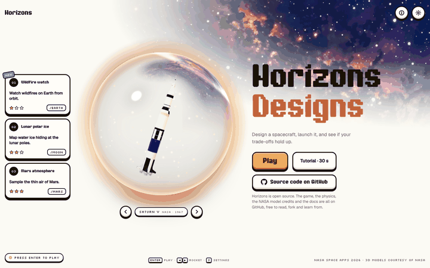

*No install, no account. Runs on desktop and phone.*

</div>

---

## Contents

- [The game in 60 seconds](#the-game-in-60-seconds)
- [Screens](#screens) (click to expand each one)
- [Missions](#missions)
- [Rockets](#rockets)
- [How you are scored](#how-you-are-scored)
- [Controls](#controls)
- [How it works](#how-it-works)
- [Repository layout](#repository-layout)
- [Run it locally](#run-it-locally)
- [Team](#team)
- [AI disclosure](#ai-disclosure)
- [Credits](#credits)

---

## The game in 60 seconds

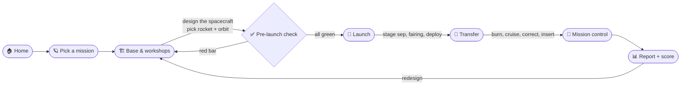

1. **Pick a planet.** Every glowing world has one mission, modelled on a real NASA one (Landsat, LRO, MAVEN, Juno, Cassini, Voyager 2, New Horizons and more).
2. **Build the spacecraft** in a walk-around isometric base. Carry parts from the subsystem stations to the build stand: bus, solar wings or RTG, battery, comms dish, storage, engine, fuel and up to three instruments. Six gauges (mass, budget, power, data, comms, time) go red the moment a trade-off breaks.
3. **Pick a rocket and an orbit.** Bigger rockets lift more but cost more. The delta-v gauge tells you if you can get there.
4. **Launch.** A hangar cinematic, then a real ascent: the autopilot flies the gravity turn, *you* fire each event on cue: throttle down for Max-Q, stage separation, second-stage ignition, fairing, engine cutoff, deploy.
5. **Fly the transfer:** the transfer burn, a cruise with time warp, a course correction, then orbit insertion or a flyby.
6. **Run the mission** from mission control. The spacecraft you built is simulated phase by phase, with random events and decisions.
7. **Read your report.** A score out of 100, explained line by line, compared with your last flight and with the real NASA mission.

> **First time, or judging?** Press **Tutorial**. Your two lead engineers, **Mevin** on the ground and **Pawan** in flight, walk you through one whole mission. It's hands-free: press **Next** at every step and the game does each action for you, from mission select to the final report (about 5 minutes).

---

## Screens

<details open>
<summary><b>🏠 Home</b>: pick a rocket in the glass ball, then Play</summary>
<br>


The NASA rockets spin inside a glass ball (◀ ▶ to switch). Settings hold difficulty (Cadet, Pilot, Commander), sandbox mode, music, sound and graphics.
</details>

<details>
<summary><b>🪐 Mission select</b>: ten worlds, ten missions</summary>
<br>
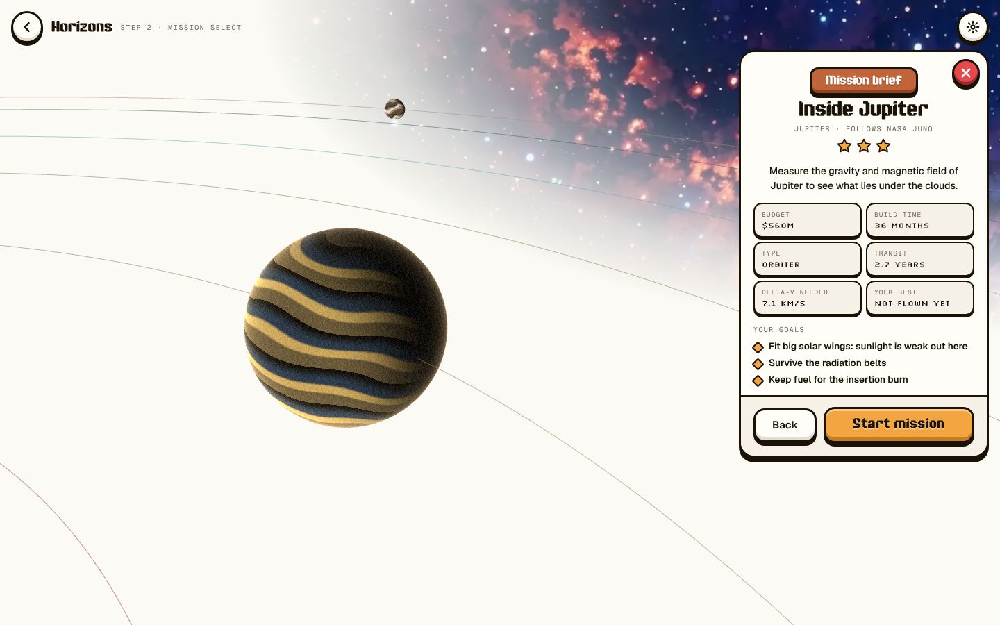

Each brief shows the objective, three science goals, the budget, the build time, the delta-v needed and your best score so far.
</details>

<details>
<summary><b>🏗️ Base and spacecraft workshop</b>: walk, carry, mount</summary>
<br>
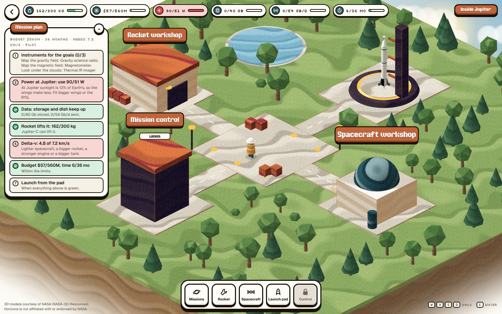
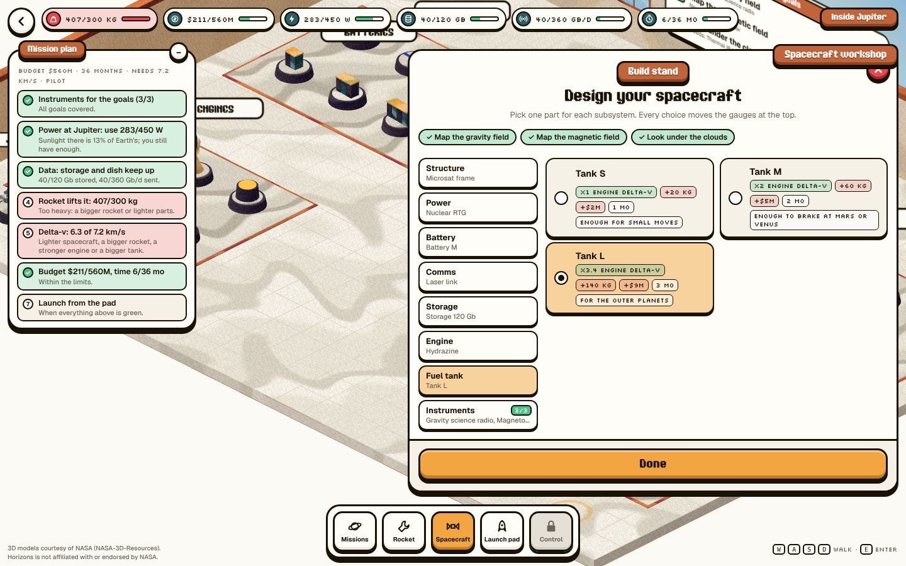

The craft on the build stand is *the* craft: the same one is loaded into the fairing, deployed in orbit, flown on the transfer and drawn in mission control.
</details>

<details>
<summary><b>🛠️ Rocket workshop</b>: five NASA rockets and a hall of fame</summary>
<br>
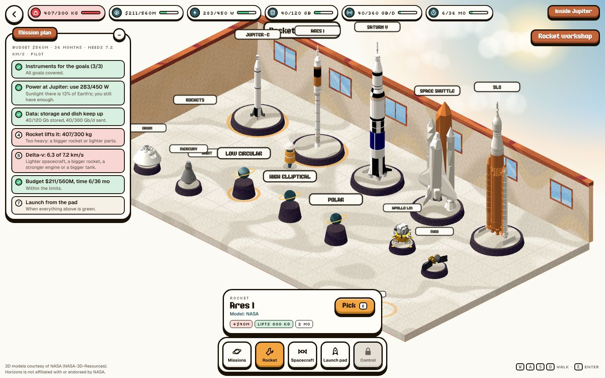

Jupiter-C, Ares I, Saturn V, Space Shuttle and SLS, plus Orion, Mercury, the Apollo Lunar Module and the Mars Reconnaissance Orbiter on display.
</details>

<details>
<summary><b>✅ Pre-launch check</b>: every bar must be green</summary>
<br>
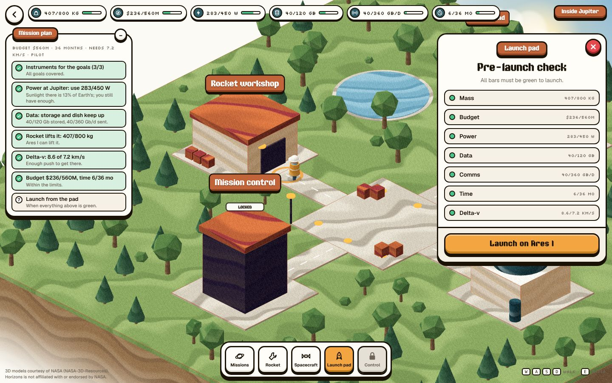
</details>

<details>
<summary><b>🚀 Launch</b>: hangar, pad, ascent, staging</summary>
<br>
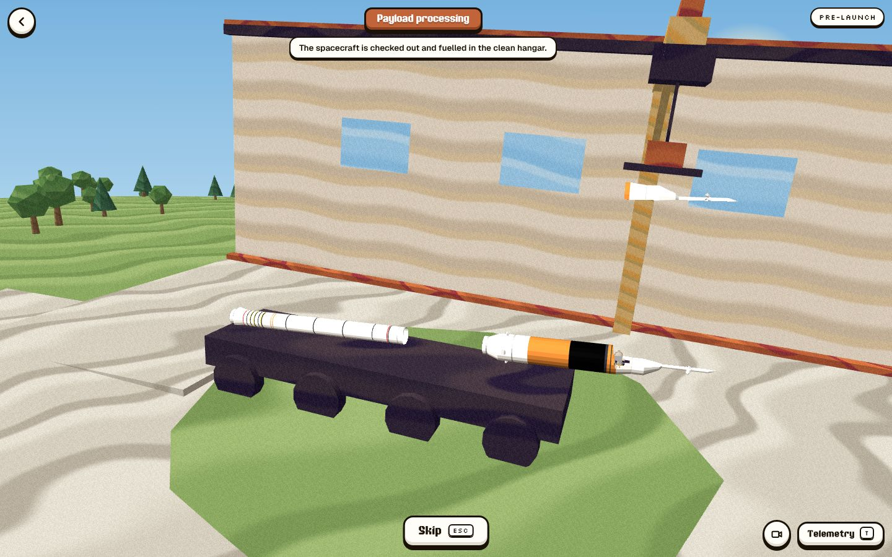 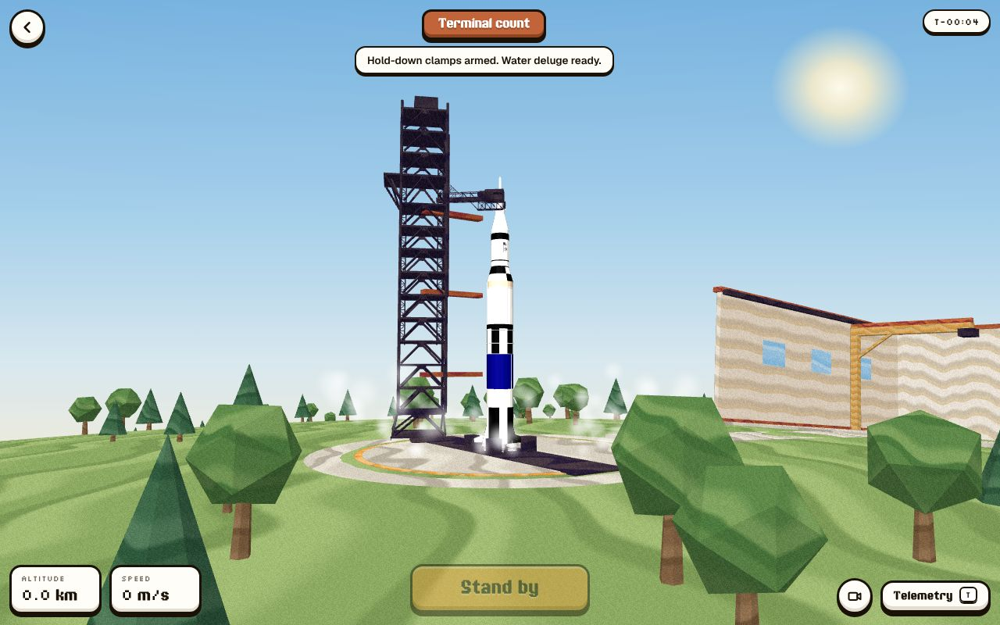
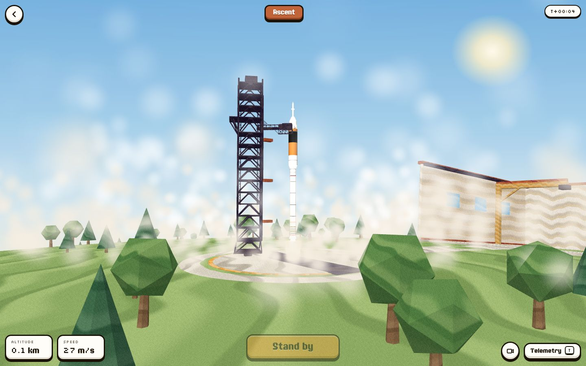 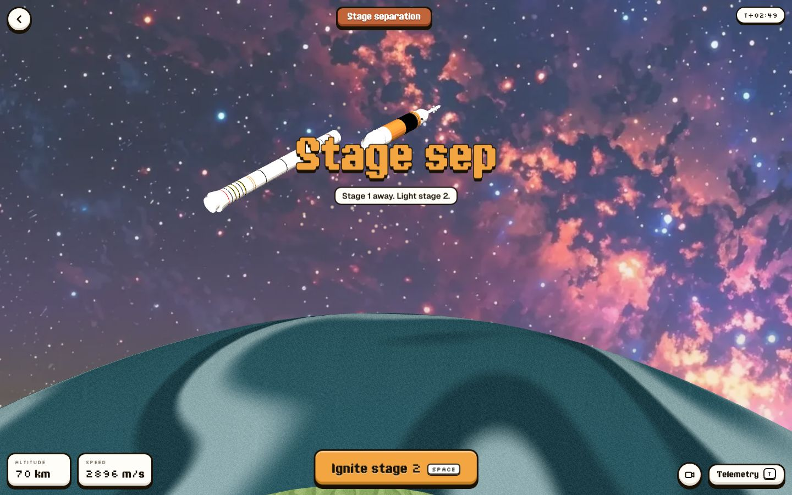

Ascent physics (thrust, drag, gravity turn, Max-Q, staging) run in `tools/sim/ascent.cjs`, the same file the headless tests use.
</details>

<details>
<summary><b>🌌 Transfer</b>: burn, cruise, correct, arrive</summary>
<br>
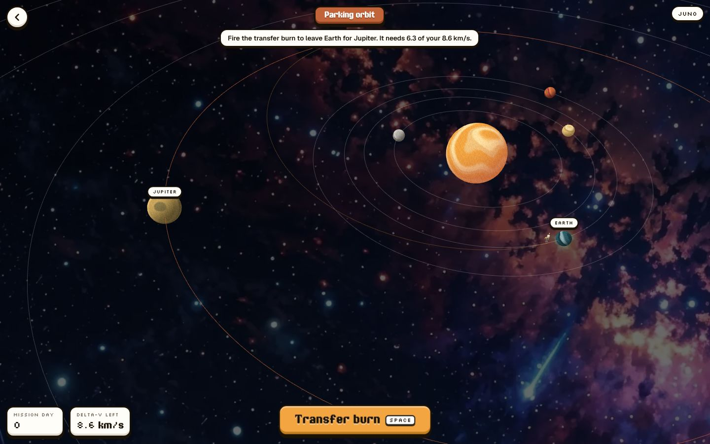 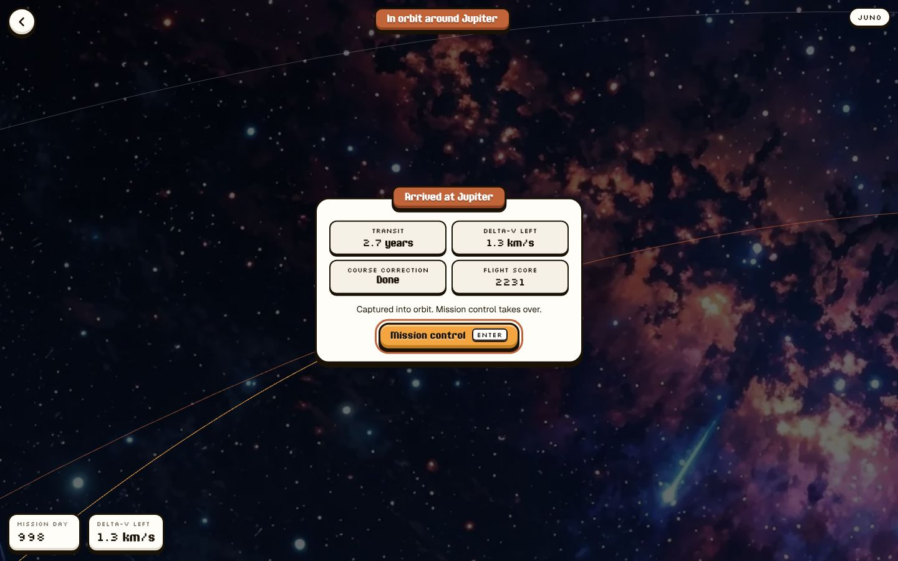
</details>

<details>
<summary><b>📡 Mission control and 📊 report</b></summary>
<br>
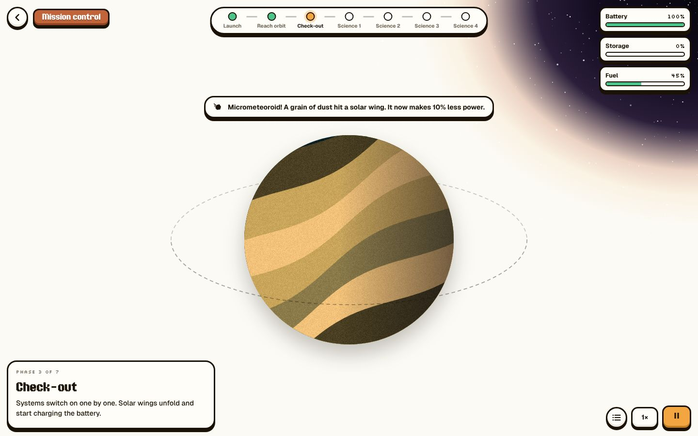 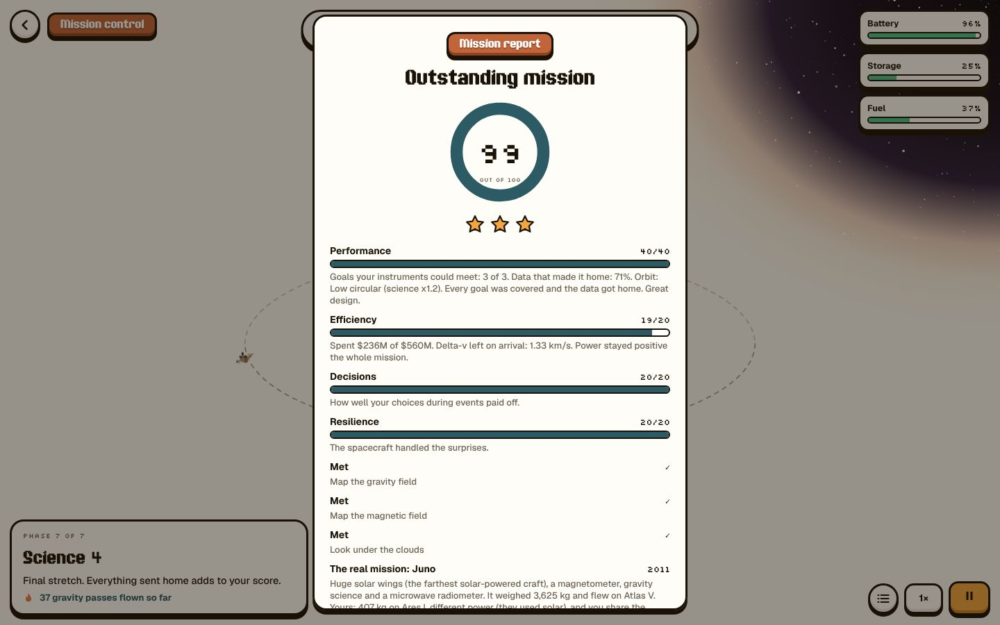

Power falls with distance from the Sun, data piles up until the dish can send it home, and every decision trades science against safety.
</details>

<details>
<summary><b>🧑‍🚀 Tutorial</b>: coached by the lead engineers</summary>
<br>
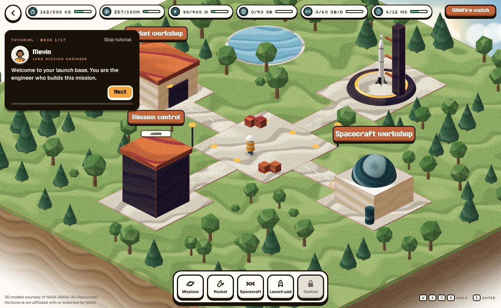 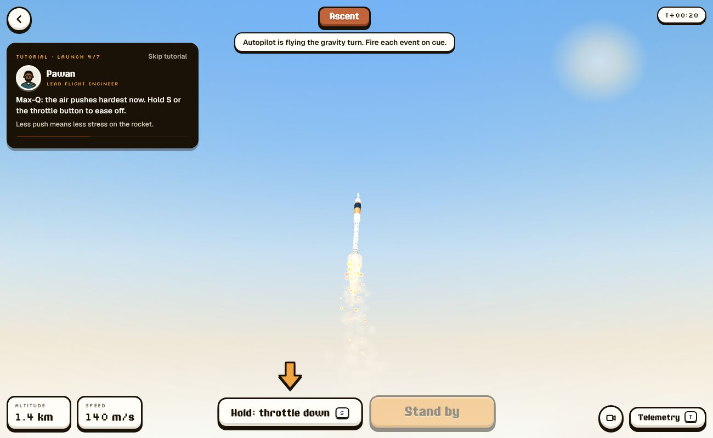
</details>

<details>
<summary><b>📱 On a phone</b></summary>
<br>
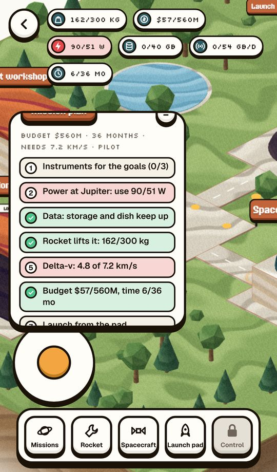
</details>

---

## Missions

| World | Mission | Type | Real NASA mission behind it |
|---|---|---|---|
| 🌍 Earth | Wildfire watch | Orbit | Landsat 8 |
| 🌕 Moon | Lunar polar ice | Lunar orbit | Lunar Reconnaissance Orbiter |
| 🔴 Mars | Mars atmosphere | Orbiter | MAVEN |
| ☿️ Mercury | Mercury mapper | Orbiter | MESSENGER |
| 🟡 Venus | Venus radar | Orbiter | Magellan |
| 🟠 Jupiter | Inside Jupiter | Orbiter | Juno |
| 🪐 Saturn | Rings and Titan | Orbiter | Cassini-Huygens |
| 🔵 Uranus | Ice giant flyby | Flyby | Voyager 2 |
| 🔷 Neptune | Edge of the planets | Flyby | Voyager 2 |
| ⚪ Pluto | Pluto flyby | Flyby | New Horizons |

After each flight the report puts your design next to the real one: its mass, rocket, power source and instruments.

## Rockets

| Rocket | Lifts | Cost | Notes |
|---|---|---|---|
| Jupiter-C | 300 kg | $15M | Small and cheap: fine for Earth orbit |
| Ares I | 800 kg | $40M | Good for the Moon and Mars |
| Saturn V | 2000 kg | $90M | Huge push for the outer planets |
| Space Shuttle | 2600 kg | $110M | Heavy lift, less delta-v |
| SLS | 4000 kg | $140M | The most push and the highest price |

<details>
<summary><b>Why a bigger rocket isn't always better</b></summary>
<br>

Delta-v falls as the payload gets heavier (`hzRocketDv` in `tools/sim/missions.js`). Every mission has a delta-v budget for the launch, the transfer burn and the insertion. Pick a rocket that is too small and you stall in the parking orbit; pick one that is too big and the budget runs out before the instruments are paid for.
</details>

## How you are scored

| Part | Points | What earns them |
|---|---|---|
| Performance | 40 | Science goals met, data returned |
| Efficiency | 20 | Money and mass left over, without cutting corners |
| Decisions | 20 | The calls you made when events hit |
| Resilience | 20 | Batteries, storage and fuel never ran dry |

Cadet gives a gentler budget and more push (×0.9 score), Commander a tighter one (×1.15). Sandbox removes the limits and isn't ranked. Your five best flights per mission are kept in this browser.

## Controls

| Action | Keyboard | Touch |
|---|---|---|
| Walk the base | <kbd>W</kbd> <kbd>A</kbd> <kbd>S</kbd> <kbd>D</kbd> or arrows | On-screen joystick |
| Pick up, mount, enter | <kbd>E</kbd> | Tap the prompt |
| Fire the next launch event | <kbd>Space</kbd> | The glowing button |
| Throttle down at Max-Q | Hold <kbd>S</kbd> | Hold the throttle button |
| Telemetry | <kbd>T</kbd> | Telemetry button |
| Play from home | <kbd>Enter</kbd> | Play |

---

## How it works

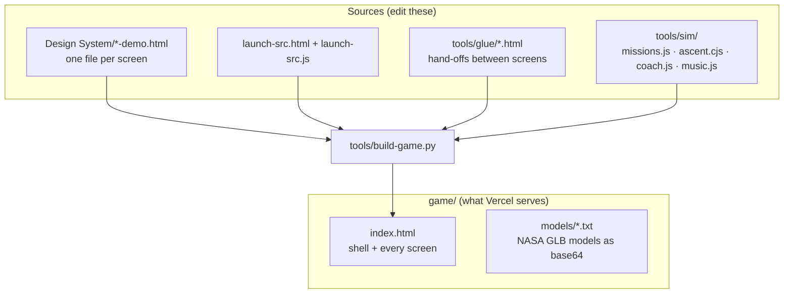

- **No framework, no build server.** The shell page loads each screen into one full-screen frame and hands over state (mission, parts, the exported 3D craft) with `postMessage`. A cream iris wipe covers each hand-off.
- **three.js r128** draws everything 3D. NASA models are flattened to their dominant colours at load, so there are no logos or markings.
- **Physics:** a 2D ascent integrator (thrust, drag, gravity turn, staging), patched-conic transfers with real delta-v budgets, and a power model where sunlight falls with distance.
- **Music:** one generative Web Audio score that changes with each phase (pad, countdown, ascent, orbit, cruise, arrival, win, lose).
- **Saves:** settings and your best flights stay in `localStorage`. Nothing leaves the browser.

---

## Repository layout

```
Horizons/
├── game/                 ← the playable game (deployed as a static site)
│   ├── index.html        ← GENERATED by tools/build-game.py, don't edit by hand
│   └── models/           ← NASA models as base64 text
├── Design System/        ← screen sources, fonts, design notes, NASA .glb originals
├── tools/
│   ├── build-game.py     ← builds game/index.html from the sources
│   ├── glue/             ← code that links the screens together
│   ├── sim/              ← missions, ascent physics, tutorial coach, music
│   ├── model-convert/    ← NASA model conversion scripts
│   └── test-*.mjs        ← Playwright tests (tutorial, full mission, balance, launch)
├── game-mechanics/       ← The Horizon Explorers standalone launch simulator (Pawan)
├── docs/
│   ├── screenshots/      ← the images in this README
│   ├── team/             ← lead engineer avatars
│   └── dev/              ← integration plan and design-run notes
├── vercel.json           ← serves game/ with no build step
├── CONTRIBUTING.md
└── LICENSE
```

## Run it locally

You need Python 3 (and Node.js only for the tests).

```bash
git clone https://github.com/Mevin-9710/Horizons.git
cd Horizons
npm start          # or: python3 -m http.server 8765 --directory game
```

Open http://localhost:8765. Opening the file straight from disk won't work because the models are fetched over HTTP.

<details>
<summary><b>Build and test</b></summary>
<br>

```bash
npm run build            # rebuild game/index.html after changing a source
npm install              # once, installs Playwright for the tests
npm run test:tutorial    # plays the whole tutorial like a player
npm run test:tutorial-auto  # plays it pressing only Next
npm run test:full        # one full mission, design to report
npm run test:balance     # every mission has a feasible design
npm run test:launch      # drives a launch
```

Tests expect the game served on port 8765 (`npm start` in another terminal). CI checks that `game/index.html` matches its sources on every push.
</details>

<details>
<summary><b>Deploy</b></summary>
<br>

Import the repo in Vercel. `vercel.json` already serves `game/` as a static site with no build step. Any static host works: upload the `game/` folder.
</details>

---

## Team

**Team HZN** (say it "Horizon").

<table>
<tr>
<td align="center" width="50%"><br><b>Mevin Joseph Seby</b><br><sub>Lead mission engineer</sub></td>
<td align="center" width="50%"><br><b>Pawan Indalkar</b><br><sub>Lead flight engineer · creator of <a href="./game-mechanics">The Horizon Explorers launch simulator</a></sub></td>
</tr>
</table>
<sub>Portraits drawn in code (SVG), written with AI assistance.</sub>

**What the team did.** Horizons is Mevin and Pawan's project from start to finish:

- **The idea and the game design:** a mission-design game where every trade-off is visible, from the parts you mount to the rocket you pick, and a report that explains the score.
- **The launch mechanics:** Pawan built The Horizon Explorers, the launch and transfer simulator (ascent, Max-Q, staging, Hohmann transfers) that Horizons' launch is based on, and sourced its NASA models.
- **The look:** Mevin led the design direction: the references, the cream-and-ink "Tactile" style, the screen designs and the isometric base.
- **The science:** choosing the ten destinations and the real NASA missions behind them, the instruments, the rockets and the numbers.
- **Every decision and every test:** the team played each build, found what felt wrong and decided what to change, round after round.

Contributions are welcome. See [CONTRIBUTING.md](./CONTRIBUTING.md).

## AI disclosure

NASA Space Apps asks teams to say where Super Intelligence (SI) tools were used. Here is exactly where:

| Where | What the AI did | Marked |
|---|---|---|
| **Code** | The team used **Claude** (Anthropic), in Claude Code, as a coding assistant. The team set the goals, designed the features and reviewed and tested every change; Claude helped write and refactor the code to that direction (screens, simulation glue, build script, tests). | This section; commit trailers (`Co-Authored-By`); `aiDisclosure` in `package.json`; `ai-disclosure` meta tag in the game; the game's Credits |

**No generative AI images, video or audio.** Everything you see and hear is made by code or comes from NASA:

- The two lead-engineer portraits are vector drawings written in code (SVG).
- The music is synthesised live by the game's code (Web Audio).
- The 30-second demo video is put together by code from real gameplay screenshots. Its music is a track the team chose (zec53, Pixabay); the launch sounds (roar, crackle, countdown beeps) are synthesised in code.
- The tutorial voice is the browser's built-in speech.

As a precaution, because the code that draws them was written with AI help, the portraits in the game and the demo video carry a small **"AI-assisted"** mark.

**Made by the team, not AI:** the idea, the game design and every design decision; The Horizon Explorers simulator; the NASA research.

**From others:** the NASA 3D models and mission data (NASA); the home-screen sky image (a free wallpaper owned by the team); the fonts; the README screenshots, which are captures of the real game.

## Credits

- **3D models courtesy of NASA** ([NASA 3D Resources](https://science.nasa.gov/3d-resources/)). Full list and processing notes: [`Design System/models/CREDITS.md`](./Design%20System/models/CREDITS.md).
- Mission data follows the real NASA missions listed above.
- Fonts: [Game Paused DEMO](https://dharmasfoundry.com/game-paused) by Dharmas Studio (free for personal and non-commercial use), [Silkscreen](https://fonts.google.com/specimen/Silkscreen) and [Geist](https://fonts.google.com/specimen/Geist) (SIL Open Font License). See [`Design System/fonts/`](./Design%20System/fonts/).
- Built with [three.js](https://threejs.org/).
- Home-screen night sky (`Design System/assets/home-sky.webp`): a free wallpaper owned by the team, used non-commercially.
- Demo video music: "Piano and Strings Ambient (Confident and Light)" by zec53, from Pixabay (Pixabay Content License), chosen by the team (`docs/demo/music/`).
- **Design inspirations are not ours.** [`Design System/Design Inspirations/`](./Design%20System/Design%20Inspirations/) holds screenshots and pages from Perplexity, Pinterest artists and an isometric asset pack, kept only as design references. All rights are reserved by their owners; none of it ships in the game.

Horizons is not affiliated with or endorsed by NASA.

**Licence:** code under the [MIT licence](./LICENSE). NASA models follow the [NASA Images and Media Usage Guidelines](https://www.nasa.gov/nasa-brand-center/images-and-media/). Fonts keep their own licences.
